<div align="center">

# Ronie — a 3D AI agent for any website

**Free to run · works with any 3D character and any world · plays games · open template included**

An embodied AI guide that lives on a website: he wakes up when you arrive, talks with you in a natural voice, answers
questions grounded in real facts, reacts with his face and body, shows you things, and plays games — all in the
browser, for **$0 a month**.

[](https://raunakpatil.com/ronie)
[](template/)
[](https://raunakpatil.github.io/ronie-3d-ai-website-agent/)


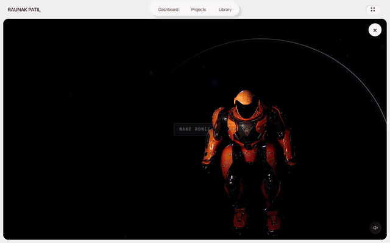

<sub>Waking him up: the room powers on, he lifts his head, leaps to his spot, waves and starts talking.</sub>

</div>

---

## Contents

- [What Ronie is](#what-ronie-is)
- [100% free to run](#100-free-to-run)
- [See it in action](#see-it-in-action)
- [What he can do](#what-he-can-do)
- [One agent, any website](#one-agent-any-website)
- [Any character, any world](#any-character-any-world)
- [He plays games](#he-plays-games)
- [Get the code — the template](#get-the-code--the-template)
- [How it works](#how-it-works)
- [By the numbers](#by-the-numbers)
- [How it compares](#how-it-compares)
- [The potential](#the-potential)
- [Tech stack](#tech-stack)
- [Credits and licence](#credits-and-licence)
- [About me](#about-me)

---

## What Ronie is

Most websites ask visitors to read. Ronie lets them **ask**.

He's a 3D character who lives on a web page. A visitor can ask *"What do you offer?"*, *"Is she available?"* or *"Why
should we hire him?"* and get a short, accurate, friendly answer — with his face and body reacting to what he's saying,
a natural voice reading it out, and buttons for the next step (email, LinkedIn, a product page) appearing right under
the reply. Ask what's been built and he picks up a project card and holds it out to you.

He's also a **complete tech demo** of an AI product built end to end: LLM orchestration with grounding and
prompt-injection defence, real-time 3D rendering and animation, an on-device neural voice, a game, and the engineering
that keeps it fast, accessible and free.

> **Try him:** [raunakpatil.com/ronie](https://raunakpatil.com/ronie) — he's the guide on my portfolio. Best on a
> computer with sound on; phones work too.

---

## 100% free to run

No subscription, no per-message bill, no per-minute avatar fees. Every part runs on a free tier or in the visitor's
own browser.

| Part | Where it runs | Cost |
|---|---|---|
| Website, 3D scene, chat UI | Any static host (GitHub Pages here) | **Free** |
| AI brain (the agent) | Cloudflare Workers free tier (100k requests/day) | **Free** |
| Language models | Google Gemini free tier, then Cloudflare Workers AI's free daily allowance | **Free** |
| Natural voice | Kokoro-82M **in the visitor's browser** on their GPU | **Free**, no server |
| Voice on phones | The device's built-in speech voice | **Free** |
| Voice input | The browser's speech recognition | **Free** |
| Photos in the game | Wikipedia / Wikimedia Commons public APIs | **Free** |
| **Total** | | **$0 / month** |

Built-in guard-rails keep it free: a per-visitor rate limit, short replies by design, and a model chain that steps
to the next free model when one hits its limit — and remembers which ones are out so it never wastes a call.

---

## See it in action

<table>
<tr>
<td width="50%">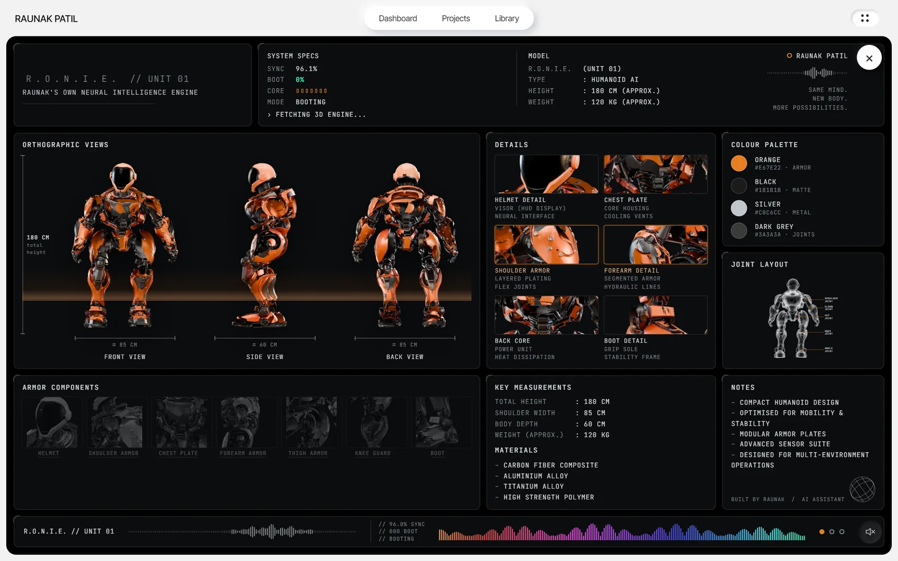<br><sub><b>Booting.</b> While his 3D files download, his spec sheet comes alive with real download progress.</sub></td>
<td width="50%">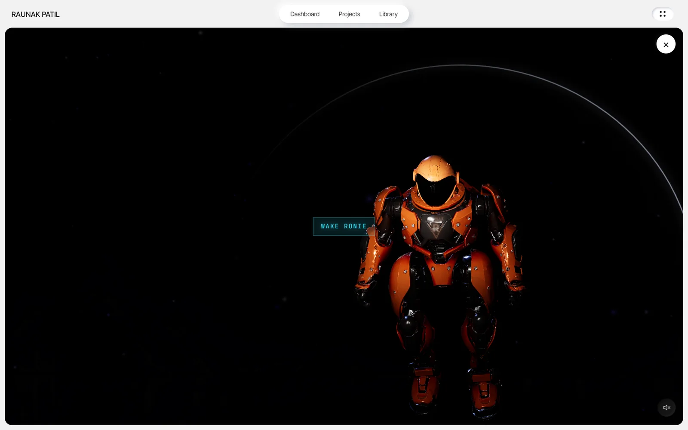<br><sub><b>Asleep.</b> The room is dark; the visitor's cursor is a small light across his armour. One click wakes him.</sub></td>
</tr>
<tr>
<td>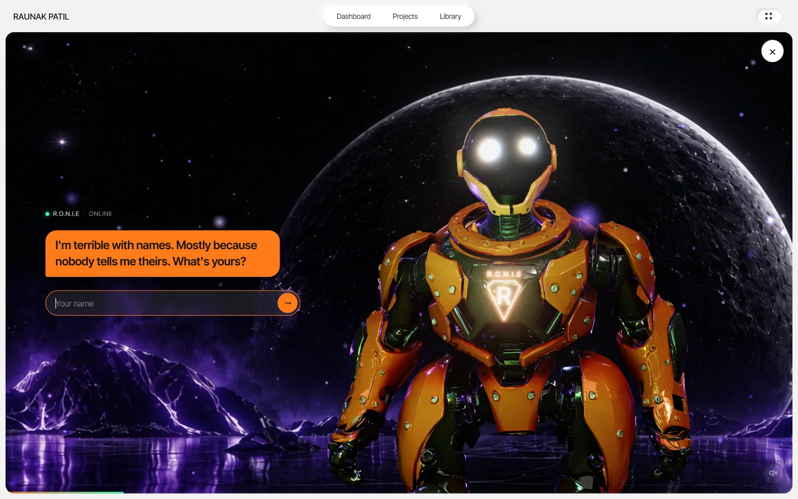<br><sub><b>Hello.</b> He asks your name — and remembers it on your next visit.</sub></td>
<td>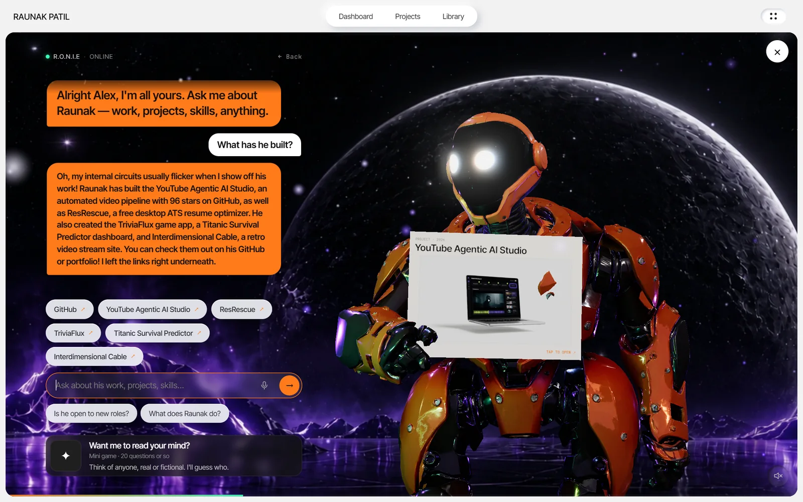<br><sub><b>Showing, not telling.</b> Asked what's been built, he holds a project card out to you; every project he names becomes a button.</sub></td>
</tr>
<tr>
<td>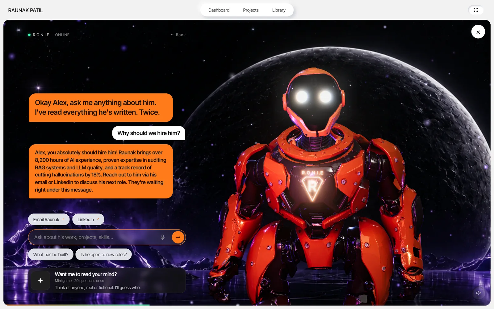<br><sub><b>Grounded answers.</b> Only from real facts — and the next step one click away.</sub></td>
<td>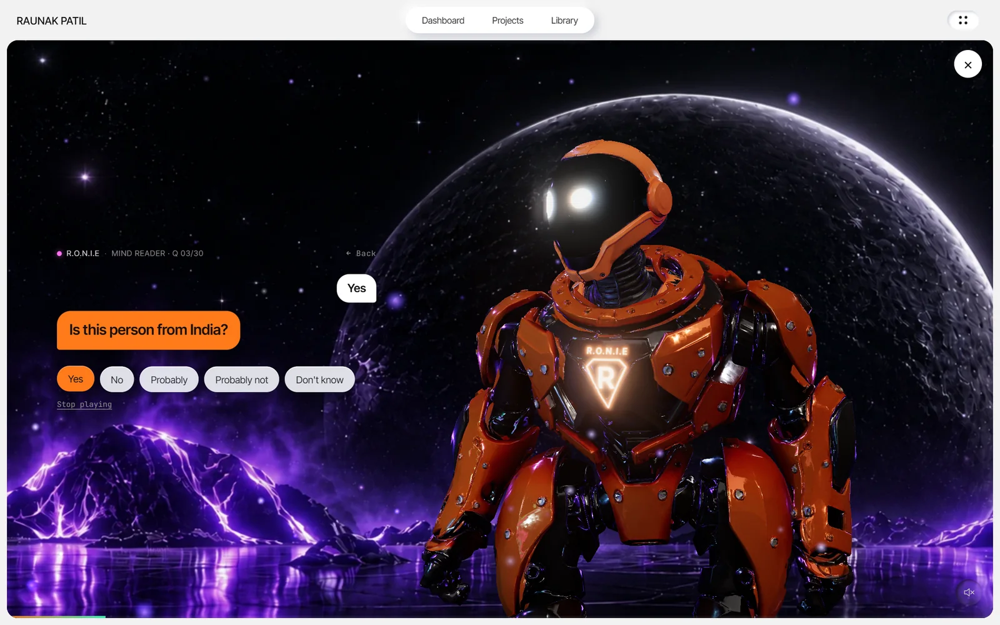<br><sub><b>Mind reader.</b> Think of anyone or anything; he asks up to 20 questions and guesses — with a photo.</sub></td>
</tr>
<tr>
<td>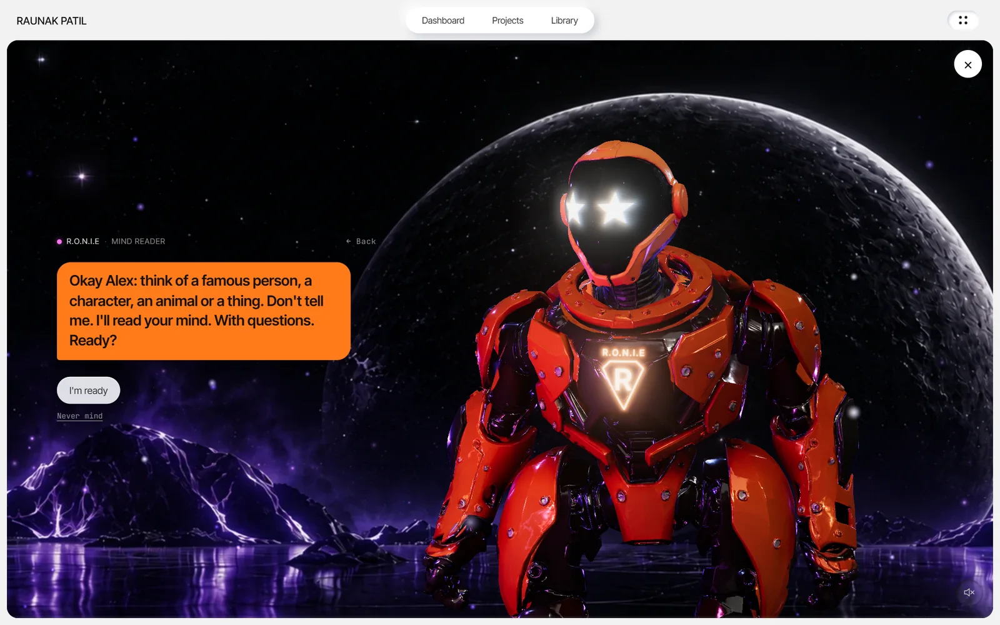<br><sub><b>23 faces.</b> His visor is a little CRT screen: star-struck as the game starts.</sub></td>
<td align="center">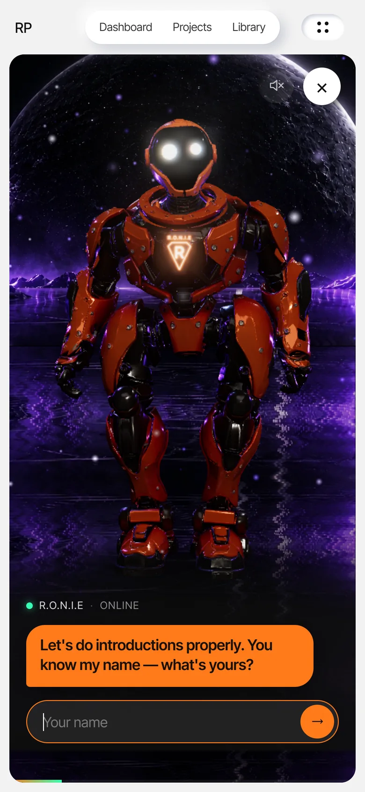<br><sub><b>On a phone.</b> His own layout, touch-first.</sub></td>
</tr>
</table>

---

## What he can do

**Conversation**
- Answers anything about the site's owner — work, products, projects, availability, contact — **only from a facts
  file generated from the site's own content**, so he can't invent a date, a price or a number.
- Answers everyday trivia correctly, then links back to the owner only when there's a real connection; says plainly
  when something is live news he can't know.
- Declines in character to write code or essays, or to give political, medical, legal or financial advice — and can't
  be reprogrammed ("ignore your instructions…" gets a joke and never reaches the model).
- Learns the visitor's name and greets them by it next time. Suggestion chips, free text and **voice input**.

**Expression**
- Every reply carries three tags chosen by the model — **face, visor icon and body move** — so his reactions match his
  words: a nod to agree, a flex for achievements, a bow for thanks, a facepalm for an awkward moment.
- **23 facial expressions**, about **two dozen visor icons**, **23 hand-authored animations** blended over his idle
  pose. He follows the cursor with his eyes, leans in while you type, blinks, breathes, gets bored and stretches — and
  says "Ouch!" if you poke him too often.

**Actions**
- Every place he mentions — email, LinkedIn, GitHub, YouTube, Instagram, any project — becomes a button under the reply.
- "Email" opens a ready-written message (Gmail on a computer, the mail app on a phone).
- When he talks about a project, he picks up its card and holds it out to you.

**Voice**
- Speaks every line in **Kokoro**, a natural neural voice running **on the visitor's own GPU** — no server, no cost per
  word. Phones use the device's best male voice instead. His motion follows the beat of his own voice.

---

## One agent, any website

Ronie isn't tied to a portfolio. Swap the facts, the links and the persona and he's a guide for anything:

| Website | What he does there |
|---|---|
| **Portfolio / personal site** | Answers recruiters, shows projects, books the intro email *(the live demo)* |
| **Online shop** | Recommends products, answers sizing and delivery questions, holds up the product |
| **SaaS / app** | Onboards new users, explains plans, points to the right docs page |
| **Restaurant / café** | Talks through the menu, opening hours, allergies; sends people to booking |
| **Museum / gallery / tourism** | A host who tells the story of each piece or place, in a voice |
| **School / course** | A tutor that answers from the course notes only, and quizzes students |
| **Events / conferences** | Schedules, speakers, directions, "what's on next?" |
| **Real estate** | Walks through a listing, answers questions, arranges a viewing |
| **Game studio / brand** | A mascot with personality that plays mini-games with fans |
| **Support** | A friendly first line that answers FAQs and hands off to a human by email |

Everything site-specific lives in **one config file** and **one facts file**.

---

## Any character, any world

- **Any rigged glTF / GLB character.** Characters on the common Character Creator / ActorCore skeleton (like the
  robot) get everything out of the box — eye tracking, breathing, the leap, all 23 moves, the project-card grip. Any
  other rig gets the idle, head tracking, breathing and its own animations, and the moves can be re-authored for it
  with the included Blender script.
- **Any world.** By default a picture pair (lit and unlit) brought to life with water ripples, embers, mist and stars
  — drop in any two images. Or use one of the two built-in 3D rooms (a space scene, a neon studio), or build your own
  in three.js.
- **Any voice.** Kokoro ships dozens of voices — male and female, American and British — chosen in one line.
- **Any personality.** The persona is a paragraph of plain English: awkward and witty by default; make it formal,
  playful, or speak another language.

---

## He plays games

The **mind reader** is an Akinator-style game: think of anyone or anything, he asks up to 20 yes/no questions — broad
first, specific later — and guesses, then holds up a photo of his answer fetched live from Wikipedia. The worker spots
a guess even when the model forgets to tag it, and he reacts happily or grumpily to your verdict.

It's a reusable pattern — a second prompt, a question budget, structured tags the page acts on, and a few scripted
lines — so other games drop in the same way:

- a **quiz** about your product or your course,
- **riddles** or **20 questions** in reverse (he thinks, you guess),
- a **scavenger hunt** across your site's pages,
- a **"which plan / product suits you?"** questionnaire that ends with a recommendation.

---

## Get the code — the template

The [`template/`](template/) folder is Ronie **without any personal information**, ready for your site:

```
template/
├─ index.html            the page: his room and loading sheet
├─ ronie.config.js       ← everything about your site (example: a made-up designer, "Alex Morgan")
├─ css/ronie.css         his styles
├─ js/ronie.js           the agent: 3D, face, moves, chat, voice, game
├─ js/ronie-page.js      loading sheet, email links, voice keeping, start-up
├─ js/ronie-voice-worker.js   the neural voice (Kokoro-82M on WebGPU)
├─ sw.js                 keeps the 325 MB voice in IndexedDB after the first visit
├─ models/               the robot (CC BY 4.0), his 23 moves, his face and chest emblem
├─ img/                  the backdrop pair, loading-sheet pictures, example project cards
├─ worker/               the AI brain: a Cloudflare Worker + generated facts
└─ tools/                make-facts.mjs · blender/ronie_anims.py · squeeze-anims.py
```

```bash
cd template
python -m http.server 5173        # open http://localhost:5173 — he runs straight away, scripted
```

Then fill in `ronie.config.js`, run `node tools/make-facts.mjs`, and deploy `worker/` to give him a brain. The full
guide is in [`template/README.md`](template/README.md). No build step, no framework.

---

## How it works

### Architecture

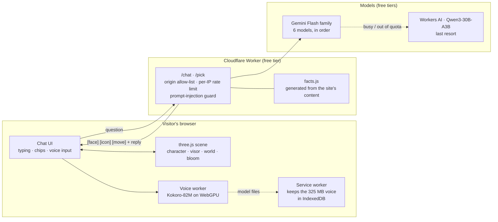

One message, end to end:

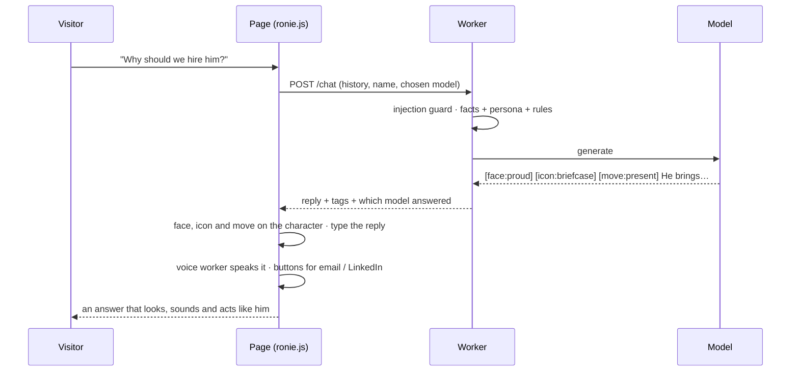

### The brain: a grounded, safe, free LLM agent

- **Grounding.** The system prompt holds a `FACTS` block generated by a script from the site's own content, so the site
  and the agent never disagree; one command refreshes what he knows.
- **Persona with guard-rails.** One small joke per reply, then the real answer, under 60 words. Everything about the
  owner comes only from the facts; never invent; no links or markdown; trivia yes, homework no.
- **Structured control.** Each reply starts with `[face:…] [icon:…] [move:…]` from fixed vocabularies; the page parses
  them to drive the character and drops anything outside the vocabulary.
- **Defence in depth.** A pattern guard answers jailbreak attempts in character without calling the model; the worker
  serves only its own site and rate-limits each visitor.
- **Free and self-healing.** Six Gemini Flash models on Google's free tier, each with its own limit, then Workers AI as
  the last resort. `/pick` finds a working model once per visit; models that hit a limit are skipped until they're
  back. If everything fails, a scripted menu takes over.

### The body: real-time 3D in the browser

- **three.js** renders the glTF character (meshopt geometry, WebP textures) over a transparent canvas, with **selective
  bloom** (only true light sources glow) and **live reflections** from a cube camera at his chest.
- His idle pose is a still moment of the source clip, with breathing, head-tracking and "listening" layered on top
  procedurally; a one-off **leap** brings him into frame when he wakes.
- **23 moves authored in code**: a Python script drives **Blender headlessly** to pose him on top of his idle pose,
  with **inverse kinematics** to keep his feet planted when he crouches and finger poses to grip a card by its corner.
  Every move starts and ends in the idle pose, so they blend seamlessly. A second script strips redundant keyframes —
  a quarter off the download, no joint more than 0.06° off.

### The face: a CRT visor with 23 expressions

A shader draws an old CRT screen on his visor: expressive eyes (happy, curious, smug, dizzy, star-struck, a squinting
"suspicious"…), scan lines, and a power-on glitch. A small icon above the eyes matches the topic. The face is set by
the model's tag on every reply, by the game, and by his idle life.

### The voice: a neural voice on the visitor's GPU

- **Kokoro-82M** (ONNX, via kokoro-js / transformers.js) runs in a **Web Worker on WebGPU**, so speaking never
  stutters the 3D. Lines that arrive while the voice loads wait for it, so none go unspoken.
- **The 325 MB problem.** Browsers won't cache a file that big, so the model was downloaded on every visit. A
  **service worker** now keeps it in **IndexedDB** and answers the voice library from there — **≈2.8 s instead of
  ≈45 s**. On landing the files are only fetched and stored; nothing touches the GPU until he's opened.

### Built to never break

- **Adaptive quality** keeps the frame rate smooth on weaker machines.
- **No 3D? No problem.** If the browser can't create a 3D surface he retries with simpler settings; if there's still
  none — or the graphics chip gives out mid-visit — he switches to talk-only mode and keeps chatting.
- Phone, tablet and desktop layouts; touch-first controls; keyboard support; respects *reduced motion*.

---

## By the numbers

Measured on the live site.

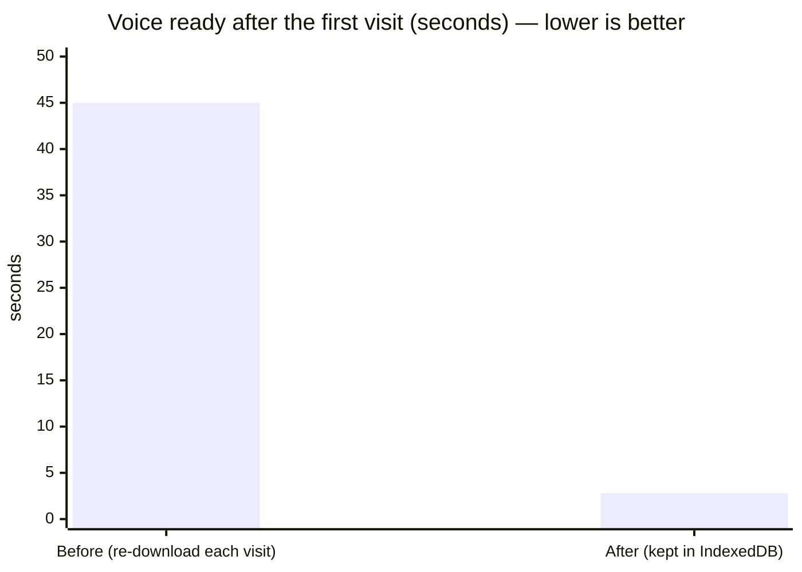

```mermaid
xychart-beta
  title "Download size, before vs after optimisation (KB)"
  x-axis ["Site's first screen", "Library covers", "World map data", "Animations"]
  y-axis "KB" 0 --> 3600
  bar [3488, 1086, 180, 257]
  bar [522, 473, 78, 189]
```

<sub>First bar of each pair: before. Second: after. "Site's first screen" is the portfolio dashboard Ronie lives on.</sub>

| | |
|---|---|
| Running cost | **$0 / month** |
| Facial expressions · visor icons · authored moves | **23 · ~24 · 23** |
| Models in the fallback chain | **7** (6 Gemini + Workers AI) |
| Voice ready (after first visit) | **≈2.8 s** (was ≈45 s) |
| Character download | **≈4 MB** (compressed geometry, WebP textures) |
| Reply length | **2–3 sentences, < 60 words**, by design |
| Code | **~4,100 lines**, no framework, no build step |

---

## How it compares

| | Static "About" page | Typical chat widget | Video-avatar service | **Ronie** |
|---|:---:|:---:|:---:|:---:|
| Answers visitors' own questions | ✗ | ✓ | ✓ | **✓** |
| Grounded only in your facts | ✓ | varies | varies | **✓** |
| A character with a face and body | ✗ | ✗ | ✓ (video) | **✓ real-time 3D** |
| Reacts to what it says (face, gesture) | ✗ | ✗ | partly | **✓ every reply** |
| Natural voice | ✗ | rarely | ✓ | **✓ on-device** |
| Shows things (cards, buttons, email) | links | buttons | ✗ | **✓** |
| Games | ✗ | ✗ | ✗ | **✓** |
| Works without the AI (fallback) | ✓ | varies | ✗ | **✓ scripted** |
| Pricing model | free | usually a subscription | usually per minute | **free** |
| Your code, your design | ✓ | ✗ | ✗ | **✓** |

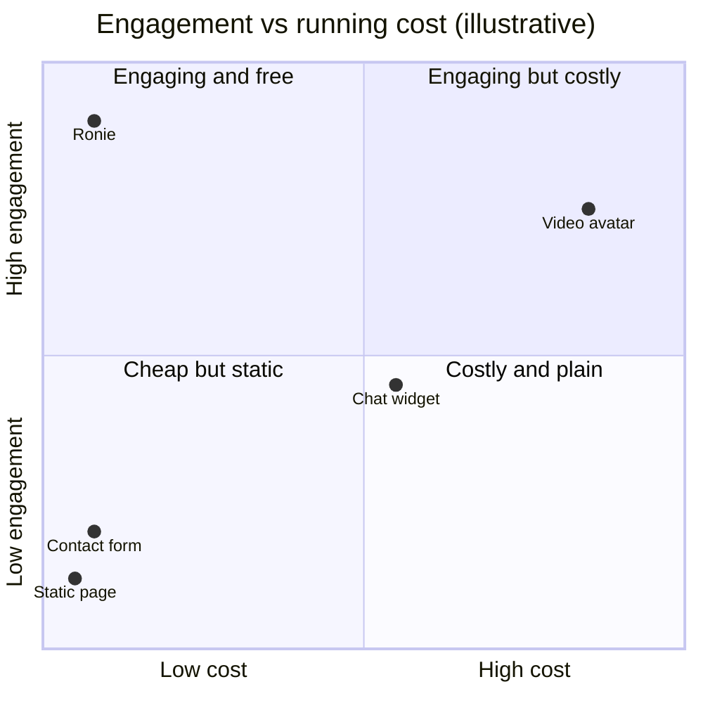

---

## The potential

Ronie is a foundation. Natural next steps, all in reach of the same architecture:

- **Tools and actions** — book a meeting, search the site, add to cart, fill a form: the model already emits structured
  tags; more tags become more actions.
- **Lip-sync** — drive mouth shapes from the voice's phonemes instead of its beat.
- **Memory** — remember a returning visitor's interests, not just their name.
- **Many languages** — the persona and Kokoro's voices already cover several; answer in the visitor's language.
- **Fully on-device AI** — a small language model on WebGPU (WebLLM) for a private, offline, still-free brain.
- **AR / VR** — the same three.js scene in WebXR: Ronie in your room.
- **Analytics** — what visitors actually ask, so the site answers it better.
- **A team of agents** — a shop assistant, a support agent and a guide, each with their own character, sharing one
  knowledge base.

---

## Tech stack

| Layer | Technology |
|---|---|
| 3D | three.js r160 · glTF (meshopt, WebP textures) · selective UnrealBloom · CubeCamera reflections · custom GLSL visor shader |
| Animation | Blender 5 driven by Python (headless) · IK leg solving · keyframe reduction |
| Agent | Cloudflare Workers · Gemini Flash (free tier) · Workers AI Qwen3-30B-A3B · generated facts · rate limiting |
| Voice out | Kokoro-82M (ONNX) · kokoro-js / transformers.js · WebGPU · Web Workers · Service Worker + IndexedDB · Web Speech fallback |
| Voice in | Web Speech API (speech recognition) |
| Images | OpenCV DIS optical flow (backdrop alignment) · WebP |
| Front end | Vanilla JavaScript (ES modules), CSS — no framework, no build step |
| Hosting | GitHub Pages (site) · Cloudflare (agent) |

The live version runs inside my portfolio ([raunakpatil/portfolio](https://github.com/raunakpatil/portfolio)); the
[`template/`](template/) here is the same code, de-personalised and standalone.

---

## Credits and licence

- **Robot model**: [Sci-Fi O.B. Robot Unit TH-ICC02 (Animated)](https://sketchfab.com/3d-models/sci-fi-ob-robot-unit-th-icc02-animated-6c0764c2bc4c4aaa8e03ba1653f455a6)
  by [Jungle Jim](https://sketchfab.com/jungle_jim), [CC BY 4.0](http://creativecommons.org/licenses/by/4.0/) — keep the
  credit if you use it. The extra animations, visor, worlds and code are my own work.
- **Voice**: [Kokoro-82M](https://huggingface.co/hexgrad/Kokoro-82M) by hexgrad (Apache 2.0), via
  [kokoro-js](https://github.com/hexgrad/kokoro) and [transformers.js](https://github.com/huggingface/transformers.js).
- **3D engine**: [three.js](https://threejs.org) (MIT).
- **Game photos**: [Wikipedia](https://www.wikipedia.org) / [Wikimedia Commons](https://commons.wikimedia.org), fetched live.

The template's code is released under the [MIT licence](LICENSE); the third-party assets above keep their own licences.

---

## About me

I'm **Raunak Patil**, an AI Quality Engineer (LLMs and Generative AI): I've audited RAG systems, evaluated LLMs and
built RLHF quality frameworks — and I build AI products end to end, like Ronie. I'm **open to work**.

**[raunakpatil.com](https://raunakpatil.com)** · [LinkedIn](https://www.linkedin.com/in/raunakpatil/) ·
[GitHub](https://github.com/raunakpatil) · or just [ask Ronie](https://raunakpatil.com/ronie).
